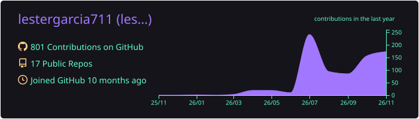
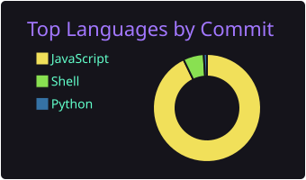
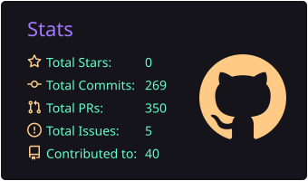

  

  

---

## Sobre mí

Soy <strong>Técnico en Desarrollo de Software</strong> con enfoque en el <strong>frontend</strong> (páginas web con HTML, CSS y JavaScript) y en el <strong>backend</strong> con <strong>Python</strong> y bases de datos <strong>MySQL</strong>.

Durante mi formación en <strong>Campuslands</strong> he desarrollado proyectos académicos y personales, trabajando con <strong>Visual Studio Code</strong> y control de versiones con <strong>Git y GitHub</strong>.

Actualmente:
- 🌱 Aprendiendo: Node.js

## Stack tecnológico

| Área | Tecnologías |
|:---:|:---|
| **Frontend** |  |
| **Backend** |  |
| **Bases de datos** |  |
| **Herramientas** |  |

Node.js: en proceso de aprendizaje.

## Proyectos destacados

| Proyecto | Qué resuelve | Tecnologías | Demo |
|:---|:---|:---|:---:|
| **Campus Shop Online** Tienda de ropa en línea | Facilita la venta de ropa por internet y la actualización de nuevos productos para atraer más clientes. | `HTML` `CSS` | [Ver demo](https://lestergarcia711.github.io/campus-shop-online/) |
| **Sistema Campus Parking** Gestión de parqueadero | Mejora el servicio al cliente, evita la pérdida de datos y agiliza el manejo de la información. | `HTML` `CSS` `JavaScript` | [Ver demo](https://lestergarcia711.github.io/sistema-campus-parking/) |

## Actividad en GitHub

    

  
  

## Contribuciones diarias

  <a href="https://github.com/lestergarcia711">
    <picture>
      <source media="(prefers-color-scheme: dark)" srcset="https://raw.githubusercontent.com/lestergarcia711/lestergarcia711/output/github-snake-dark.svg" />
      <source media="(prefers-color-scheme: light)" srcset="https://raw.githubusercontent.com/lestergarcia711/lestergarcia711/output/github-snake.svg" />
      
    </picture>
  </a>

## Mi forma de trabajar

- No trabajo directamente sobre `main`; uso ramas separadas por responsabilidad.
- Organizo las carpetas del proyecto con criterio.
- Documento cada integración o modificación.
- Escribo commits claros y profesionales, en infinitivo.
- Integro los cambios mediante Pull Requests.

---

📫 **lestergarcia711@gmail.com** · 🌐 [Portafolio](https://lester-garcia-dev.vercel.app/) · 💼 [LinkedIn](https://www.linkedin.com/in/lester-garcia-dev/)

¿Tienes una idea o una oportunidad? Escríbeme, con gusto conversamos.

